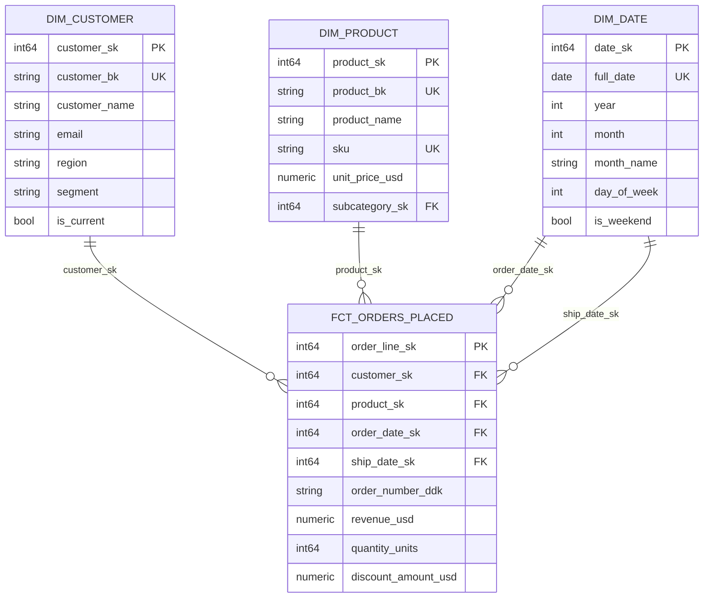

# ERD Generator

## Step 1: Gather Input

Accept any of the following input formats — ask the user to provide one if nothing is given:

1. **SQL DDL** — `CREATE TABLE` statements (most precise; FK constraints extracted directly)
2. **Prose description** — "I have a customers table with id, name, email. Orders table with id, customer_id (FK), order_date, total. Order_lines table with id, order_id (FK), product_id (FK), quantity, unit_price."
3. **Existing schema documentation** — a table/column list from a data dictionary or README

If the input has more than ~25 tables, offer to generate a subject-area view (a subset of the most important tables) instead of the full diagram. Rendering large ERDs is impractical in most tools.

## Step 2: Parse the Schema

Extract from the input:

**Tables:**
For each table, note:
- Table name
- Column name, data type
- Primary key declaration
- UNIQUE constraints
- NOT NULL constraints on FK columns (determines relationship cardinality)

**Relationships:**
For each FOREIGN KEY, note:
- Child table + child column
- Parent table + parent column
- Is the FK column NOT NULL? (YES → mandatory relationship `||`; NO → optional `o|`)
- Is there a UNIQUE constraint on the FK column? (YES → one-to-one `||--||`; NO → many `{`)

Build an internal map:
```
[child_table] --(child_col FK)--> [parent_table].(parent_col PK)
cardinality: [1:1 | 1:M | M:M]
optionality: [mandatory | optional]
```

## Step 3: Map Cardinality to Mermaid Notation

Use this reference to determine the correct Mermaid relationship notation:

| Relationship | Mermaid Symbol | Meaning |
|---|---|---|
| One-to-many (mandatory child) | `\|\|--o{` | Parent is required; child has zero or many |
| One-to-many (mandatory both) | `\|\|--\|{` | Both sides required; child has one or many |
| One-to-one (mandatory both) | `\|\|--\|\|` | Exactly one on each side |
| One-to-one (optional child) | `\|\|--o\|` | Parent required; child is optional |
| Many-to-many | `}o--o{` | Zero or many on each side |
| One-to-many (nullable FK) | `\|\|--o{` | Most common FK pattern |

**Determination rules:**
- FK column is NOT NULL → use mandatory (`|`) on the child side
- FK column is NULLable → use optional (`o`) on the child side
- FK column has UNIQUE constraint → one-to-one; else many (`{`) on the child side

## Step 4: Generate the Mermaid Diagram

Produce the complete Mermaid `erDiagram` block. Annotate each column with `PK`, `FK`, or `UK` as appropriate.



**Notes on Mermaid erDiagram syntax:**
- Entity names must be alphanumeric + underscore; no spaces
- Column format: `<type> <name> <annotation>` where annotation is one of `PK`, `FK`, `UK`, or blank
- Mermaid does not support composite primary keys natively — note them in a comment above the diagram block
- Relationship label (the string after the colon) is optional but recommended for clarity

## Step 5: Add Composite Key Notes

If any table has a composite primary key that cannot be expressed in Mermaid syntax, add a comment block above the diagram:

```
%% Note: FCT_ORDER_LINE has a composite PK: (order_sk, line_number_sk)
%% Note: SAT_CUSTOMER_CRM has a composite PK: (customer_hk, load_date)
```

## Step 6: Produce a Relationship Verification Table

In addition to the diagram, produce a plain-text table listing all relationships for cross-checking:

| Child Table | Child Column | Parent Table | Parent Column | Cardinality | Nullable FK? |
|---|---|---|---|---|---|
| `fct_orders_placed` | `customer_sk` | `dim_customer` | `customer_sk` | Many-to-one | No |
| `fct_orders_placed` | `product_sk` | `dim_product` | `product_sk` | Many-to-one | No |
| `fct_orders_placed` | `ship_date_sk` | `dim_date` | `date_sk` | Many-to-one | Yes (ship date optional) |

## Step 7: Rendering Instructions

Include these instructions with the output:

**To render this diagram:**

- **GitHub / GitLab** — Paste the Mermaid block (including the triple-backtick fence with `mermaid` tag) directly into a Markdown file. Both platforms render it natively.
- **VS Code** — Install the [Mermaid Preview](https://marketplace.visualstudio.com/items?itemName=bierner.markdown-mermaid) extension, then open the `.md` file in Preview mode.
- **Confluence** — Use the Mermaid macro (available via the Mermaid for Confluence plugin).
- **draw.io** — In the Extras menu, select "Edit Diagram" and paste the Mermaid code.
- **mermaid.live** — Paste directly at https://mermaid.live for instant rendering.

## Wrap-Up Output Format

---

## ERD: `<Schema / System Name>`

> **Composite key notes (if any):**
> - `TABLE_NAME`: composite PK = (col1, col2)

```mermaid
erDiagram

    TABLE_ONE {
      ...
    }
    ...

    TABLE_ONE ||--o{ TABLE_TWO : "fk_col"
    ...
```

### Relationship Reference Table
| Child Table | FK Column | Parent Table | PK Column | Cardinality | Nullable |
|---|---|---|---|---|---|

### Rendering Instructions
...

---

## Self-Check Before Finalising

- [ ] Every FK reference in the diagram points to a table that is declared in the same diagram
- [ ] Mermaid syntax is valid: entity names are alphanumeric/underscore, no spaces in names
- [ ] Cardinality symbols are correct per the nullable/non-nullable FK rule
- [ ] Composite primary keys are noted in comments (not silently ignored)
- [ ] Relationship verification table is complete and matches the diagram
- [ ] If input had >20 tables: a subject-area subset is offered or a limitation is noted
- [ ] Rendering instructions are included
